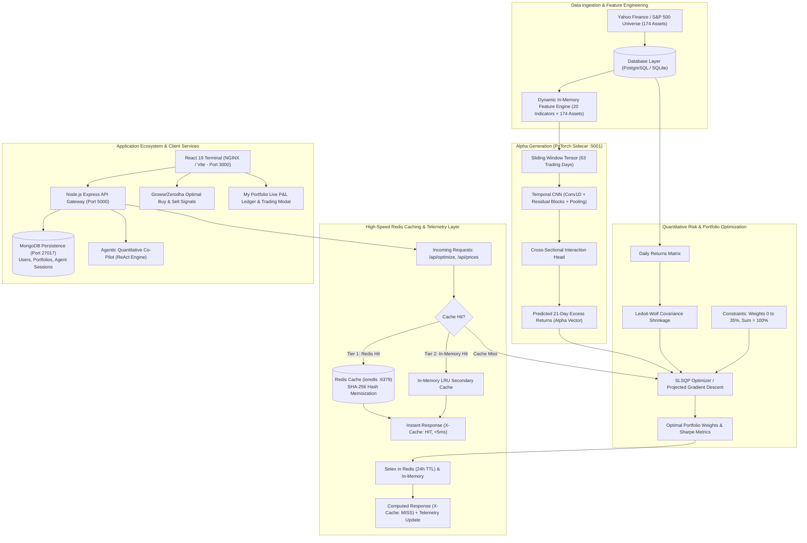

# RiskFrame

**Deep Learning Alpha Generation, Constrained Portfolio Optimization Terminal & High-Speed Redis Caching Engine**

[](https://www.python.org/)
[](https://pytorch.org/)
[](https://nodejs.org/)
[](https://expressjs.com/)
[](https://redis.io/)
[](https://www.mongodb.com/)
[](https://react.dev/)
[](https://www.docker.com/)
[](LICENSE)

---

## Executive Overview

Modern Portfolio Theory (Markowitz, 1952) establishes that optimal capital allocation depends on expected asset returns and their mutual covariance. However, in practical quantitative finance, naive sample-based mean-variance optimization suffers from the **error maximization phenomenon**:
1. **Sample Means Are Extremely Noisy**: Historical trailing returns exhibit weak predictive power for future price trajectories. Feeding raw historical averages into an optimizer results in extreme, fragile portfolio weights.
2. **Sample Covariance Matrices Overfit**: When the number of assets $N$ is large relative to historical observations $T$, sample covariance matrices $\mathbf{S}$ suffer from eigenvalue dispersion, underestimating actual out-of-sample portfolio variance.
3. **High Latency Optimization Overhead**: Repeatedly running high-dimensional quadratic programming solvers across thousands of user queries introduces severe latency bottlenecks without an intelligent memoization cache.

**RiskFrame** resolves these structural limitations through an enterprise microservice architecture coupling deep learning, quantitative optimization, high-throughput caching, and an institutional trading terminal:
- **Predictive Alpha Engine**: A specialized **Temporal Convolutional Network (Temporal CNN)** ingests 63-day lookback windows across 20 engineered technical indicators to predict **21-day forward excess returns** (market-relative alpha) for 174 S&P 500 assets and macro ETFs.
- **Robust Risk Estimation**: Implements **Ledoit-Wolf covariance shrinkage**, pulling the empirical covariance matrix toward an optimal structured target to eliminate estimation noise.
- **Dual Optimization Engines**: Employs **Sequential Least Squares Programming (SLSQP)** in Python for non-linear Sharpe maximization under single-position concentration limits ($w_i \le 35\%$) and full investment ($\sum w_i = 1$), backed by an autonomous **JavaScript Projected Gradient Descent solver** for zero-downtime microservice resilience.
- **High-Throughput Dual-Tier Redis Caching Engine**: Deploys a production Redis 7 caching tier featuring deterministic SHA-256 parameter hashing, sub-millisecond response times for cached optimizations, telemetry metrics tracking (hits, misses, hit ratio), and transparent fallbacks to an in-memory LRU layer.
- **Autonomous Agentic Quantitative Co-Pilot**: An integrated ReAct reasoning agent capable of parsing natural language financial queries, invoking quant tools, evaluating portfolio risk metrics, and persisting customized allocations to MongoDB.
- **Interactive Terminal & Trading Hub**: A modern React 19 web terminal featuring Groww and Zerodha-style optimal buy/sell order signals, live portfolio P&L ledgers, trade execution dialogs, user authentication, and interactive Chart.js visualizations.

---

## System Architecture



---

## Quantitative Methodology

### 1. Alpha Formulation & Target Normalization

Rather than predicting raw price changes—which are dominated by broader market beta—RiskFrame predicts **cross-sectional excess return (alpha)** over a 21-day forward investment horizon ($H = 21$ trading days, approximately one calendar month):

$$R_{i, t \to t+H} = \frac{P_{i, t+H}}{P_{i, t}} - 1$$

$$\alpha_{i, t} = R_{i, t \to t+H} - \frac{1}{N}\sum_{j=1}^{N} R_{j, t \to t+H}$$

Subtracting the equal-weighted cross-sectional market return forces the neural network to isolate idiosyncratic asset performance rather than macroeconomic momentum. Expected returns are subsequently annualized for the optimizer:

$$\hat{\mu}_i = \alpha_{i, \text{predicted}} \times \left(\frac{252}{H}\right)$$

### 2. Temporal Convolutional Neural Network (Temporal CNN)

Traditional recurrent architectures (LSTMs, GRUs) suffer from sequential processing bottlenecks, vanishing gradients over long lookbacks, and sensitivity to step-by-step noise. RiskFrame uses 1D temporal convolutions with residual skip connections:

```text
Input Tensor: [Batch, Window=63, Assets=174, Features=20]
      │
      ▼ Reshape: Decouple temporal extraction per asset
[Batch × 174, Channels=20, Length=63]
      │
      ▼ Input Projection: Conv1D(20 → 64, kernel=3, pad=1) + BatchNorm1d + ReLU
      │
      ▼ Residual Stack: 2 × ResidualBlock(64 Channels, Dropout=0.20)
      │   ├── Conv1D(64 → 64, kernel=3, pad=1) + BatchNorm1d + ReLU
      │   ├── Conv1D(64 → 64, kernel=3, pad=1) + BatchNorm1d + Dropout(0.20)
      │   └── Skip Connection: Output = ReLU(x + F(x))
      │
      ▼ Global Temporal Pooling: AdaptiveAvgPool1d(1)
[Batch × 174, 64]
      │
      ▼ Reshape & Cross-Asset Flattening
[Batch, 174 × 64 = 11,136]
      │
      ▼ Cross-Sectional Interaction Head
      │   Linear(11136 → 128) + ReLU + Dropout(0.20) + Linear(128 → 174)
      ▼
Output Tensor: [Batch, 174] (Predicted excess returns for all assets)
```

**Key architectural features:**
- **Shared Temporal Feature Extraction**: Early convolution layers share weights across all 174 assets, ensuring the model learns universal technical indicator dynamics without overfitting to individual tickers.
- **Cross-Sectional Interaction Head**: Flattening the pooled representations of all assets into a unified linear layer allows the network to model inter-asset dependencies and relative cross-sectional rankings.
- **Huber Loss Criterion**: Trained using Huber loss ($\delta = 1.0$), providing quadratic penalties for moderate deviations while behaving linearly for extreme market outliers, preventing parameter destabilization during sudden market shocks.

### 3. Ledoit-Wolf Covariance Shrinkage

In sample covariance estimation $\mathbf{S} = \frac{1}{T-1} \mathbf{X}^T \mathbf{X}$, small eigenvalues are underestimated and large eigenvalues are overestimated when $N \approx T$. This leads to unstable, highly leveraged portfolio weights. 

RiskFrame applies Ledoit-Wolf shrinkage to produce a well-conditioned covariance matrix $\hat{\mathbf{\Sigma}}_{\text{LW}}$:

$$\hat{\mathbf{\Sigma}}_{\text{LW}} = \delta \mathbf{F} + (1 - \delta) \mathbf{S}$$

where $\mathbf{F}$ is a structured shrinkage target (constant correlation model) and $\delta \in [0, 1]$ is the analytically computed optimal shrinkage intensity that minimizes the expected mean squared error under the Frobenius norm. The resulting matrix is annualized by multiplying by 252.

### 4. Portfolio Optimization Formulation

Portfolio return and portfolio volatility are computed as:

$$\mu_p = \mathbf{w}^T \hat{\mathbf{\mu}}, \qquad \sigma_p = \sqrt{\mathbf{w}^T \hat{\mathbf{\Sigma}}_{\text{LW}} \mathbf{w}}$$

The optimization objective minimizes the negative Sharpe Ratio subject to institutional portfolio constraints:

$$\min_{\mathbf{w}} \quad -\frac{\mathbf{w}^T \hat{\mathbf{\mu}} - R_f}{\sqrt{\mathbf{w}^T \hat{\mathbf{\Sigma}}_{\text{LW}} \mathbf{w}}}$$

$$\text{subject to} \quad \sum_{i=1}^{K} w_i = 1, \qquad 0 \le w_i \le w_{\max} \quad (\forall i)$$

- **Risk-Free Rate ($R_f$)**: Set to 4.0% ($0.04$), reflecting current treasury yield conditions (user-customizable in account preferences).
- **Single Asset Position Limit ($w_{\max}$)**: Capped at 35% ($0.35$), preventing single-stock concentration while allowing the optimizer to tilt aggressively toward high-conviction alpha signals.
- **Solvers**:
  - **Primary**: Sequential Least Squares Programming (`scipy.optimize.minimize(method='SLSQP')`) in the Python microservice initialized from equal weights $\mathbf{w}_0 = \frac{1}{K}\mathbf{1}$.
  - **High-Speed JS Fallback**: Projected Gradient Descent maximizing Sharpe with analytical gradient steps $\frac{\partial S}{\partial w_i} = \frac{\mu_i \sigma_p - (\mu_p - R_f)(\mathbf{\Sigma w})_i / \sigma_p}{\sigma_p^2}$, box bounds $[0, w_{\max}]$, and simplex projection $\sum w_i = 1$.

---

## Core Subsystems

### 1. High-Performance Multi-Tier Redis Caching Engine

Optimization calculations involving multi-dimensional covariance matrices and quadratic programming solvers are computationally intensive ($O(N^3)$ operations). To provide instantaneous terminal interactions, RiskFrame implements a **dual-tier caching architecture** backed by **Redis 7**:

```text
┌────────────────────────────────────────────────────────────────────────┐
│                        HTTP /api/optimize Request                      │
└───────────────────────────────────┬────────────────────────────────────┘
                                    │
                                    ▼
       ┌─────────────────────────────────────────────────────────┐
       │   SHA-256 Memoization Key Generator                     │
       │   rawKey = SORTED_TICKERS : wMAX_WEIGHT : rfRISK_FREE   │
       │   key    = "rf:opt:" + sha256(rawKey)                   │
       └────────────────────────────┬────────────────────────────┘
                                    │
                                    ▼
                      ┌───────────────────────────┐
                      │    Redis Connected?       │
                      └──────┬─────────────┬──────┘
                       Yes   │             │ No
                             ▼             ▼
               ┌───────────────────┐ ┌───────────────────┐
               │ Tier 1: Redis GET │ │ Tier 2: In-Memory │
               └─────────┬─────────┘ └─────────┬─────────┘
                   Hit   │     Miss        Hit │     Miss
                         ▼       │             ▼       │
                    Return Data  │        Return Data  │
                                 ▼                     ▼
               ┌───────────────────────────────────────────────────┐
               │    Execute Quant Optimization (Sidecar / Fallback)│
               └─────────────────────────┬─────────────────────────┘
                                         │
                                         ▼
               ┌───────────────────────────────────────────────────┐
               │ Save in Redis (TTL: 24h) & In-Memory Map          │
               │ Set Headers: X-Cache: MISS, X-Response-Time-Ms    │
               └───────────────────────────────────────────────────┘
```

#### Deterministic Cache Key Derivation
To guarantee consistent cache hits regardless of ticker selection order or case sensitivity, optimization keys are normalized and hashed:
```javascript
function generateOptimizationHash(tickers, maxWeight = 0.35, riskFreeRate = 0.04) {
  const sortedTickers = [...tickers].map(t => t.toUpperCase()).sort().join(',');
  const rawKey = `${sortedTickers}:w${Number(maxWeight).toFixed(3)}:rf${Number(riskFreeRate).toFixed(3)}`;
  return crypto.createHash('sha256').update(rawKey).digest('hex');
}
// Redis key format: rf:opt:6b86b273ff34fce19d6b804eff5a3f5747ada4eaa22f1d49c01e52ddb7875b4b
```

#### Multi-Tier Strategy & TTL Policies
- **Tier 1 (Redis 7 via `ioredis`)**: Distributed cache shared across instances. Optimization results are persisted with a **24-hour TTL (86,400s)**, aligning with daily market close regimes. Stock price series are cached under `rf:prices:<TICKER>` with a **1-hour TTL (3,600s)**.
- **Tier 2 (Resilient In-Memory Fallback)**: Built-in JavaScript `Map` cache with expiration timestamps and bounded LRU-style eviction (maximum 1,000 entries). If Redis undergoes maintenance, disconnects, or encounters network partitions, requests automatically route to Tier 2 without throwing errors or increasing latency.
- **Cache Telemetry Tracking**: Real-time counters record total cache hits, misses, and set operations. Exposed via the `GET /api/cache/stats` endpoint and through custom response headers:
  - `X-Cache: HIT (redis)`: Served directly from Redis memory in $< 5\text{ms}$.
  - `X-Cache: HIT (memory)`: Served from in-memory fallback.
  - `X-Cache: MISS`: Computed fresh by the quant engine and stored in cache.
  - `X-Response-Time-Ms`: High-precision end-to-end request latency.

---

### 2. Data Ingestion & Storage Architecture

- **Multi-Asset Universe**: Covers 174 liquid instruments across all 11 S&P 500 sectors (Information Technology, Healthcare, Financials, Consumer Discretionary, Consumer Staples, Energy, Industrials, Utilities, Real Estate, Materials, Communication Services) plus diversified macro ETFs (`GLD` gold, `TLT` 20+ year treasuries, `IEF` 7-10 year treasuries, `SHY` 1-3 year treasuries, `TIP` inflation-protected bonds).
- **Dual Database Strategy**: Configured through SQLAlchemy to support PostgreSQL (e.g. Neon serverless Postgres) or local SQLite (`local_fallback.db`).
- **Dynamic In-Memory Feature Engine**: Standard relational databases enforce column limits (e.g., PostgreSQL has a 1,600-column table cap). With 174 assets and 20 features per asset, the complete feature space requires 3,480 columns. RiskFrame stores raw daily prices in the database and computes the full feature matrix dynamically in-memory upon startup and training, bypassing database schema limits and ensuring zero synchronization lag.
- **Split-Adjusted Data Synchronization**: Rather than appending unadjusted rows, daily updates perform full-window synchronization. Because corporate actions and stock splits adjust price histories retroactively, this guarantees longitudinal consistency.

---

### 3. Feature Engineering Pipeline

Each asset generates 20 statistical and technical features, standard-normalized across the lookback window ($Z = \frac{x - \mu}{\sigma + \epsilon}$):

| Feature Category | Indicators | Description |
| :--- | :--- | :--- |
| **Price & Returns** | `Price`, `Return_1`, `Return_5`, `Return_10`, `Return_20`, `Log_Return` | Daily closing prices, 1/5/10/20-day percentage changes, and continuous log returns $\ln(P_t / P_{t-1})$. |
| **Moving Average Ratios** | `MA5_Ratio`, `MA10_Ratio`, `MA20_Ratio`, `MA50_Ratio` | Ratio of current price to rolling simple moving averages ($P_t / \text{SMA}_k$), identifying medium and short-term trend extension. |
| **Volatility Metrics** | `Volatility_5`, `Volatility_20` | Rolling standard deviation of daily percentage returns over 5-day and 20-day windows. |
| **Momentum Oscillators** | `RSI`, `MACD`, `MACD_Signal`, `EMA12_Ratio`, `EMA26_Ratio` | 14-period Relative Strength Index, standard 12/26/9 MACD and signal lines, and price-to-EMA ratios. |
| **Mean Reversion** | `BB_Position` | Relative location within Bollinger Bands: $\frac{P_t - \text{Lower}}{\text{Upper} - \text{Lower}}$ where bands represent 20-day $\mu \pm 2\sigma$. |
| **Cross-Sectional Momentum** | `Rank_Return_5`, `Rank_Return_20` | Percentile return rank ($[0, 1]$) of the asset relative to all 174 assets in the universe on date $t$. |

---

### 4. Model Training & MLOps Pipeline

- **Strict Chronological Splitting**: Chronological 80% train / 20% validation split without time-shuffling to completely prevent lookahead bias.
- **Optimization**: AdamW optimizer ($lr = 10^{-3}, \text{weight decay} = 10^{-4}$) coupled with `ReduceLROnPlateau` (halving learning rate after 5 epochs without validation improvement) and gradient clipping ($\|\mathbf{g}\| \le 1.0$).
- **Early Stopping & Model Versioning**: Early stopping terminates training after 20 epochs of plateaued validation loss. Checkpoints are automatically synced to Hugging Face Hub if credentials are provided.

---

### 5. Autonomous Agentic Quantitative Co-Pilot

RiskFrame incorporates an integrated **Quantitative Co-Pilot** operating on a **ReAct (Reasoning + Acting)** execution pattern:
- **Autonomous Tool Invocation**: Detects user investment intent, ticker symbols, and risk parameters to execute internal tools:
  - `optimizePortfolio`: Triggers Ledoit-Wolf shrinkage and quadratic optimization.
  - `analyzeRisk`: Computes maximum asset concentration, diversification health, and Sharpe score diagnostics.
  - `getUserPortfolios`: Queries active portfolios from MongoDB.
  - `savePortfolio`: Persists customized allocations to the user's account.
- **Persistent Conversation Memory**: Persists conversation history in MongoDB (`AgentSession`), providing contextual continuity across sessions.

---

### 6. Interactive Quantitative Terminal (React 19 + Vite)

- **Asset Selection**: Filter across sectors, search tickers, or deploy preset thematic baskets (e.g. *Magnificent 7*, *Dividend Kings*, *Balanced Core*, *Tech Titans*).
- **Dynamic Portfolio Optimization**: Sends user-selected subsets ($2 \le K \le 35$) to the backend optimizer, displaying real-time allocation distributions via Chart.js doughnuts and metrics tables.
- **Comparative Metrics**: Displays expected portfolio annualized return, volatility, Sharpe Ratio, alongside asset-level historical returns, volatility, and AI predicted 21-day returns.
- **Optimal Buy & Sell Signals (Groww & Zerodha Style)**: Algorithmic order hub directly advising which assets are mathematically optimal to buy and which assets are optimal to sell/exit, complete with instant order dialogs and cash margin checks.
- **My Portfolio Ledger**: Real-time holding ledger reflecting all bought assets, current market values, purchase cost basis, live unrealized P&L ($ and %), and rebalancing alignment with model targets.
- **Direct Trading Modal**: Buy and sell execution dialog validating user cash balances, simulating market fills, and updating MongoDB portfolio holdings in real time.
- **User Authentication & Preferences**: JWT-based authentication enabling users to store custom risk tolerances (maximum asset weight caps, custom risk-free rates).
- **Price Trajectory Inspector**: Dedicated chart module fetching 15-day closing price trends for any universe asset with Redis caching.

---

## Repository Structure

```text
RiskFrame/
├── server/                     # Node.js & Express 2.0 API Gateway
│   ├── src/
│   │   ├── config/
│   │   │   ├── db.js          # MongoDB connection & graceful disconnect handler
│   │   │   └── redis.js       # Redis client (ioredis) initialization & fallback logic
│   │   ├── middleware/
│   │   │   └── auth.middleware.js # JWT verification and optional authentication
│   │   ├── models/
│   │   │   ├── User.js        # User account schema with bcrypt password hashing
│   │   │   ├── Portfolio.js   # Portfolio holding schema, rebalance logs, and metrics
│   │   │   └── AgentSession.js# Conversational agent session and message history
│   │   ├── routes/
│   │   │   ├── auth.routes.js     # User registration, login, profile, preferences
│   │   │   ├── optimize.routes.js # /optimize, /prices, /signals, /cache/stats
│   │   │   ├── portfolio.routes.js# Portfolio CRUD, rebalance, and trade execution
│   │   │   └── agent.routes.js    # Agentic Co-Pilot chat and session management
│   │   ├── services/
│   │   │   ├── cache.service.js   # Dual-tier Redis + in-memory cache & telemetry
│   │   │   ├── quant.service.js   # Python sidecar proxy + JS Projected Gradient solver
│   │   │   └── agent.service.js   # ReAct reasoning loop with tool definitions
│   │   └── index.js           # Server bootstrap, route registration, and telemetry
│   ├── Dockerfile             # Production Node.js Alpine container
│   └── package.json           # Express, Mongoose, ioredis, Zod, jsonwebtoken dependencies
│
├── website/                    # React 19 Quantitative Web Terminal
│   ├── src/
│   │   ├── components/
│   │   │   ├── AgentCopilot/  # Conversational AI Co-Pilot drawer interface
│   │   │   ├── MyPortfolio/   # Holding ledger, asset valuations, and live P&L
│   │   │   ├── OptimalSignals/# Groww & Zerodha style algorithmic Buy/Sell signals
│   │   │   ├── Trading/       # Buy/Sell order execution dialog with margin check
│   │   │   ├── UserAuth/      # Sign in / Register modal with risk preference setup
│   │   │   ├── StockSelector/ # Sector filter, ticker search, and thematic presets
│   │   │   ├── Results/       # Allocation doughnut chart, metrics table, AI forecasts
│   │   │   ├── PriceHistory/  # 15-day price trajectory inspection chart
│   │   │   ├── Hero.jsx       # Terminal header and feature summary
│   │   │   ├── LoadingScreen.jsx # Initializing loading screen
│   │   │   └── Navbar.jsx     # Navigation bar with auth state and section tabs
│   │   ├── data/
│   │   │   ├── stocks.js      # S&P 500 universe metadata (174 assets across 11 sectors)
│   │   │   └── marketSignals.js # Real-time market signals and sample asset holding data
│   │   ├── api.js             # Frontend API client with JWT and cache-aware requests
│   │   └── App.jsx            # Top-level state coordinator and section view routing
│   ├── Dockerfile             # Multi-stage frontend Dockerfile (NGINX prod / Vite dev)
│   ├── nginx.conf             # Production NGINX reverse proxy routing /api/ to backend
│   └── package.json           # Vite, React 19, Lucide React, Chart.js dependencies
│
├── app.py                     # PyTorch Quant microservice exposing /api/optimize & /api/signals
├── model.py                   # TemporalCNN and ResidualBlock PyTorch neural network
├── dataset.py                 # PyTorch PortfolioDataset and global CONFIG schema
├── feature_eng.py             # Feature engineering pipeline (20 technical indicators per asset)
├── optimizer.py               # Ledoit-Wolf covariance shrinkage and SciPy SLSQP solver
├── data_loader.py             # Yahoo Finance historical ingestion and SQL database sync
├── train.py                   # PyTorch training loop with early stopping & HF Hub sync
├── main.py                    # CLI inference and portfolio optimization script
├── temporal_cnn_weights.pth   # Pretrained PyTorch model checkpoint
├── requirements.txt           # Python scientific stack (torch, scipy, pandas, scikit-learn)
├── Dockerfile.python          # Python Quant microservice container (Gunicorn)
├── Dockerfile                 # Standalone legacy all-in-one container
│
├── docker-compose.yml         # Production multi-container orchestration stack
├── docker-compose.dev.yml     # Zero-build hot-reloading development stack
├── scripts/
│   └── update_data.py         # Automated daily market price ingestion script
└── .github/workflows/
    ├── daily_update.yml       # GitHub Actions: Daily post-market price ingestion
    └── weekly_training.yml    # GitHub Actions: Weekly model retraining
```

---

## API Reference

The RiskFrame ecosystem exposes REST endpoints via the Node.js Express API gateway (Port 5000) and the Python Quant microservice (Port 5001):

### `POST /api/optimize`
Runs model inference and portfolio optimization for a selected subset of assets with **Redis memoization**.

**Headers Returned:**
- `X-Cache`: `HIT (redis)`, `HIT (memory)`, or `MISS`
- `X-Response-Time-Ms`: End-to-end processing latency in milliseconds

**Request Payload:**
```json
{
  "tickers": ["AAPL", "NVDA", "MSFT", "AMZN", "GOOGL"],
  "max_weight": 0.35,
  "risk_free_rate": 0.04
}
```

**Response Payload:**
```json
{
  "cached": true,
  "cacheSource": "redis",
  "runtimeMs": 3,
  "engine": "python-pytorch-slsqp",
  "allocation": {
    "AAPL": 0.2312,
    "NVDA": 0.3500,
    "MSFT": 0.1843,
    "AMZN": 0.1345,
    "GOOGL": 0.1000
  },
  "metrics": {
    "expected_return": 0.2845,
    "volatility": 0.1921,
    "sharpe_ratio": 1.2728
  },
  "ai_predictions": {
    "AAPL": 0.2450,
    "NVDA": 0.3812,
    "MSFT": 0.1980,
    "AMZN": 0.1650,
    "GOOGL": 0.1420
  },
  "individual_metrics": {
    "AAPL": {
      "historical_return": 0.2104,
      "historical_volatility": 0.2231,
      "historical_sharpe": 0.7638
    }
  }
}
```

---

### `GET /api/prices?ticker={SYMBOL}`
Returns historical closing prices over the last 15 trading days with Redis caching (1-hour TTL).

**Response Payload:**
```json
{
  "cached": true,
  "runtimeMs": 2,
  "dates": ["2026-10-10", "2026-10-13", "..."],
  "prices": [228.45, 230.12, "..."]
}
```

---

### `GET /api/signals`
Returns real-time algorithmic Buy and Sell order recommendations generated by Temporal CNN alpha inference and Ledoit-Wolf risk weighting.

**Response Payload:**
```json
{
  "buySignals": [
    { "ticker": "NVDA", "alpha": 0.3840, "price": 138.25, "change_pct": 2.40, "signal": "STRONG_BUY" },
    { "ticker": "AAPL", "alpha": 0.2860, "price": 234.80, "change_pct": 1.15, "signal": "BUY" }
  ],
  "sellSignals": [
    { "ticker": "INTC", "alpha": -0.0420, "price": 22.80, "change_pct": -1.80, "signal": "SELL" }
  ],
  "engine": "python-pytorch-slsqp",
  "timestamp": "2026-10-28T14:00:00.000Z"
}
```

---

### `GET /api/cache/stats`
Returns live telemetry metrics for the Redis and in-memory dual-tier caching layer.

**Response Payload:**
```json
{
  "hits": 142,
  "misses": 18,
  "sets": 18,
  "hitRatio": "88.8%",
  "totalRequests": 160
}
```

---

### `POST /api/agent/chat`
Conversational endpoint for the **Agentic Quantitative Co-Pilot**. Executes quantitative tool workflows and returns structured commentary.

**Request Payload:**
```json
{
  "message": "Optimize a portfolio with NVDA, AAPL, MSFT, and GLD with low risk",
  "sessionId": "671fb2c4e1a49c250b892a01"
}
```

**Response Payload:**
```json
{
  "reply": "I ran a quantitative portfolio optimization for NVDA, AAPL, MSFT, GLD using Ledoit-Wolf shrinkage and the Temporal CNN alpha forecast...",
  "toolCalls": [
    { "tool": "optimizePortfolio", "params": { "tickers": ["NVDA", "AAPL", "MSFT", "GLD"] } },
    { "tool": "analyzeRisk", "result": { "riskRating": "Moderate", "sharpeAssessment": "Strong risk-adjusted alpha" } }
  ]
}
```

---

### `GET /api/health`
System telemetry and readiness probe verifying backend components, database status, and Redis connection state.

**Response Payload:**
```json
{
  "status": "ok",
  "version": "2.0.0",
  "backend": "Node.js Express",
  "database": "MongoDB",
  "redis": "connected",
  "timestamp": "2026-10-28T14:00:00.000Z"
}
```

---

### Additional Authentication & Portfolio Endpoints

| Method | Endpoint | Description |
| :--- | :--- | :--- |
| `POST` | `/api/auth/register` | Create a new user account with initial virtual trading capital ($100,000). |
| `POST` | `/api/auth/login` | Authenticate with email/password and obtain a signed JWT token. |
| `GET` | `/api/auth/me` | Fetch active user profile, custom risk limits, and account balance. |
| `PUT` | `/api/auth/preferences` | Update `maxAssetWeight` and `riskFreeRate` preferences. |
| `GET` | `/api/portfolios` | List all saved portfolios and historical rebalance snapshots for the user. |
| `POST` | `/api/portfolios` | Save a customized portfolio allocation into MongoDB. |
| `POST` | `/api/portfolios/:id/rebalance` | Trigger automated portfolio rebalancing to align with optimal model weights. |
| `POST` | `/api/portfolios/trade` | Execute simulated market Buy/Sell order, updating cash and stock holdings. |

---

## Deployment & Zero-Config Execution with Docker Compose

RiskFrame provides complete container orchestration via **Docker Compose** so you never have to manually install Node.js, run `npm run build`, or configure Redis/MongoDB manually:

### Option A: One-Command Production Stack (Auto-built React + NGINX + API + Quant + Redis + Mongo)
```bash
docker compose up --build
```
This automatically compiles the frontend, starts NGINX on port `3000`, Express API on port `5000`, PyTorch Quant sidecar on port `5001`, Redis cache on port `6379`, and MongoDB on port `27017`.
* Access the web terminal at: **`http://localhost:3000`**
* Access the backend API at: **`http://localhost:5000/api/health`**
* Access Redis cache telemetry at: **`http://localhost:5000/api/cache/stats`**

### Option B: Zero-Build Live Hot-Reloading Development (No `npm run build` Ever Needed)
```bash
docker compose -f docker-compose.dev.yml up
```
Mounts your local source code into the containers with **Vite Hot Module Replacement (HMR)** and **Node.js watch mode**. Any code changes to `.jsx` or `.css` are reflected live in your browser instantly without restarting containers or running builds.

To stop the containers at any time:
```bash
docker compose down
```

---

## Manual Local Setup (Alternative)

If running directly on your host machine without Docker Compose:

### 1. Prerequisites
- Python 3.10+
- Node.js 20+ and npm
- Redis Server (local or containerized: `docker run -d -p 6379:6379 redis:7-alpine`)
- MongoDB (local or containerized: `docker run -d -p 27017:27017 mongo:7-jammy`)

### 2. Python PyTorch Microservice Setup
```bash
# Create virtual environment
python3 -m venv .venv
source .venv/bin/activate    # On Windows: .venv\Scripts\activate

# Install scientific dependencies
pip install -r requirements.txt

# Start Python quant sidecar on port 5001
PORT=5001 python app.py
```

### 3. Node.js Express Backend Setup
```bash
cd server
npm install

# Start Express server with auto-reload
npm run dev
```
The server connects to Redis (`redis://127.0.0.1:6379`) and MongoDB (`mongodb://127.0.0.1:27017/riskframe`) on port `5000`.

### 4. React 19 Frontend Terminal Setup
```bash
cd website
npm install

# Start Vite live development server
npm run dev
```
Access the development terminal at `http://localhost:5173` or `http://localhost:3000`.

### 5. Running CLI Inference & Retraining
To run the quantitative pipeline directly in your terminal:
```bash
python main.py
```

To retrain the Temporal CNN on fresh market data:
```bash
python train.py
```
Executes 150 epochs with early stopping (patience 20), saves optimal checkpoints to `temporal_cnn_weights.pth`, and pushes to Hugging Face Hub if credentials are configured.

---

## Configuration & Environment Variables

Key parameters can be configured via `.env` in the root and in `server/.env`:

| Variable | Scope | Default | Description |
| :--- | :--- | :--- | :--- |
| `REDIS_URL` | Express / Cache | `redis://127.0.0.1:6379` | Redis connection URL for caching and telemetry. |
| `MONGODB_URI` | Express / Mongo | `mongodb://127.0.0.1:27017/riskframe` | MongoDB connection string for users, portfolios, and agent sessions. |
| `PYTHON_QUANT_URL`| Express / Quant | `http://127.0.0.1:5001` | URL of the Python PyTorch quant optimization microservice. |
| `JWT_SECRET` | Express / Auth | `riskframe_secret_key` | Secret key used to sign and verify JWT authentication tokens. |
| `JWT_EXPIRES_IN` | Express / Auth | `7d` | Lifetime of user authentication tokens. |
| `DATABASE_URL` | Python / SQLAlchemy | `sqlite:///local_fallback.db` | SQL database connection string for historical market data. |
| `HF_MODEL_REPO` | Python / MLOps | `77RedX/RiskFrame` | Hugging Face Hub repository for weight checkpoints. |
| `HF_TOKEN` | Python / MLOps | *Empty* | Hugging Face API token for automated checkpoint uploads. |
| `PORT` | Python / Express | `5000` (Node), `5001` (Python) | Network ports for backend microservices. |
| `WINDOW_SIZE` | Python / ML | `63` | Lookback trading days for Temporal CNN feature input. |
| `PREDICTION_HORIZON`| Python / ML | `21` | Forward return horizon in trading days (alpha generation target). |
| `MAX_WEIGHT` | Global / Quant | `0.35` | Maximum individual asset weight constraint in portfolio optimization. |
| `RISK_FREE_RATE` | Global / Quant | `0.04` | Annualized risk-free benchmark rate ($4\%$) used in the Sharpe Ratio. |

---

## Automated CI/CD Workflows

The repository includes GitHub Actions for automated maintenance:
1. **Daily Market Ingestion (`.github/workflows/daily_update.yml`)**:
   Runs Monday through Friday at 21:30 UTC (4:30 PM EST, shortly after US market close). Executes `scripts/update_data.py` to refresh database prices with current market data.
2. **Weekly Model Retraining (`.github/workflows/weekly_training.yml`)**:
   Runs every Saturday at 00:00 UTC. Retrains the Temporal CNN on updated market regimes and pushes updated weights to Hugging Face Hub.

---

## Quantitative Disclaimer

> [!WARNING]
> This software is developed for research and educational purposes only. Nothing contained in this repository constitutes financial, investment, legal, or tax advice. Financial markets are subject to substantial risk of loss. Historical performance, algorithmic signals, and deep learning return predictions do not guarantee future results.
